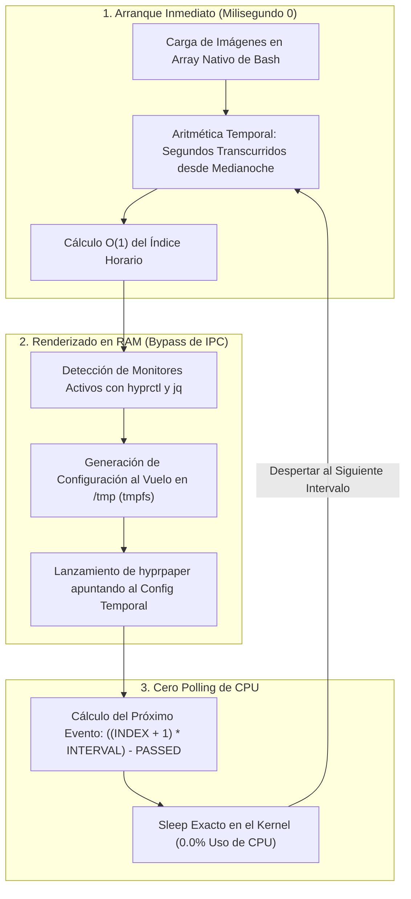

> *Crónica técnica de mi transición desde entornos de escritorio monolíticos hacia gestores de ventanas tipo tiling (Wayland / Hyprland). Los scripts, generadores y configuraciones referenciados se encuentran en mis repositorios [`0gerardo0/dynamic-gnome-wallpapers`](https://github.com/0gerardo0/dynamic-gnome-wallpapers) y [`0gerardo0/hyprland-dynamic-wallpaper`](https://github.com/0gerardo0/hyprland-dynamic-wallpaper).*
{: .prompt-info}

Cuando Apple introdujo en macOS Mojave los fondos de pantalla dinámicos de 24 horas —aquellos paisajes que transicionan sutilmente entre la luz del amanecer, el sol del mediodía y la penumbra de la noche según la hora del sistema—, me pareció una de las integraciones estéticas más elegantes que podía tener un sistema operativo. 

En Linux, quise replicar exactamente esa misma experiencia en mi máquina de trabajo. Sin embargo, mi camino para lograrlo atravesó dos etapas tecnológicas radicalmente opuestas: primero, la lucha contra la burocracia de archivos XML en GNOME y un Pull Request comunitario que quedó congelado en el tiempo; y posteriormente, la necesidad de construir mi propio motor liviano en Bash al migrar a un entorno *tiling* moderno bajo Wayland (**Hyprland**), donde no existía ningún demonio prefabricado que hiciera el trabajo por mí.

{: .shadow .rounded }
*Ciclo diurno de 24 horas (Noche, Amanecer, Día, Atardecer) integrado en mi entorno de escritorio actual.*

---

## La Etapa GNOME: El Descubrimiento y el PR Olvidado

Al investigar cómo tener fondos de pantalla dinámicos en Linux, no partí sabiendo cómo funcionaba la fontanería interna del escritorio. En su lugar, me topé con el repositorio comunitario [`dynamic-gnome-wallpapers`](https://github.com/saint-13/Linux_Dynamic_Wallpapers) (creado originalmente por Manish Kumar). 

El autor había hecho un trabajo enorme de recopilación y adaptación manual para traer a Linux los sets de imágenes de macOS. Sin embargo, la forma en que GNOME gestiona estos fondos resultó ser engorrosa y manual.

### La Mecánica Arcaica de GNOME: Dos XMLs Obligatorios

Para que GNOME reconozca un fondo dinámico con transiciones horarias, exige dos archivos XML independientes:

1. **El descriptor de propiedades (`properties.xml`):** Registra el tema dentro del panel de configuración de GNOME (`gnome-control-center`):
   ```xml
   <?xml version="1.0" encoding="UTF-8"?>
   <!DOCTYPE wallpapers SYSTEM "gnome-wp-list.dtd">
   <wallpapers>
     <wallpaper>
       <name>desert-sands</name>
       <filename>/usr/share/backgrounds/gnome/desert-sands-timed.xml</filename>
       <options>zoom</options>
     </wallpaper>
   </wallpapers>
   ```

2. **El descriptor de línea de tiempo (`timed.xml`):** Define una secuencia estricta de bloques estáticos (`<static>`) y transiciones cruzadas (`<transition type="overlay">`), donde cada segundo debe estar matemáticamente calculado para que la suma total sea exactamente de $86,400\text{ segundos}$ (un día solar completo):
   ```xml
   <background>
     <starttime>
       <year>2020</year><month>01</month><day>01</day>
       <hour>00</hour><minute>00</minute><second>00</second>
     </starttime>
     <static>
       <file>/path/to/01_night.jpg</file>
       <duration>17995.0</duration>
     </static>
     <transition type="overlay">
       <duration>5.0</duration>
       <from>/path/to/01_night.jpg</from>
       <to>/path/to/02_dawn.jpg</to>
     </transition>
     <!-- Repetir manualmente para cada imagen del paquete -->
   </background>
   ```

Redactar a mano cientos de líneas de XML, calculando duraciones estáticas restando los $5\text{ s}$ de fundido para $N$ imágenes, era una tarea propensa a errores aritméticos y muy aburrida.

### Mi Aporte: Automatización con `generate_xml.sh`

Para eliminar esa fricción, programé un script en Bash ([`generate_xml.sh`](https://github.com/0gerardo0/dynamic-gnome-wallpapers/blob/feature/add-xml-generator-script/generate_xml.sh)) que se encargaba de todo el flujo matemático y estructural:

$$\begin{aligned}
T_{\text{día}} &= 86,400\,\text{s} \\
T_{\text{trans\_total}} &= N \cdot T_{\text{trans}} \\
T_{\text{static}} &= \frac{86,400 - (N \cdot T_{\text{trans}})}{N}
\end{aligned}$$

El script escaneaba el directorio con `find`, ordenaba las imágenes lexicográficamente, calculaba los tiempos mediante `awk` y generaba tanto el XML temporizado como el descriptor del sistema con rutas parametrizadas:

```bash
# Fragmento de generate_xml.sh
local total_transition_time=$(awk -v n="$num_images" -v t="$TRANSITION_DURATION" 'BEGIN { print n * t }')
local static_duration=$(awk -v total_sec="$TOTAL_SECONDS_IN_DAY" -v trans_time="$total_transition_time" -v n="$num_images" 'BEGIN { print (total_sec - trans_time) / n }')

# Inyección automática de bloques XML
for (( i=0; i<num_images; i++ )); do
    local current_file="${image_files[i]}"
    local next_file="${image_files[(i + 1) % num_images]}"
    cat <<EOF
  <static>
    <file>${current_file}</file>
    <duration>${static_duration}</duration>
  </static>
  <transition type="overlay">
    <duration>${TRANSITION_DURATION}</duration>
    <from>${current_file}</from>
    <to>${next_file}</to>
  </transition>
EOF
done
```

Con este generador listo, abrí la rama `feature/add-xml-generator-script` y envié un Pull Request al repositorio original para que cualquier usuario de la comunidad pudiera añadir nuevos fondos sin tocar una sola línea de XML. 

Sin embargo, como ocurre a menudo en el software libre, el proyecto quedó desatendido por su mantenedor y el PR nunca fue revisado ni integrado. Lejos de desanimarme, conservé el script en mi propio repositorio y continué utilizándolo para mi entorno personal.

---

## El Eslabón Perdido: De los Contenedores `.HEIC` a Secuencias PNG

Tanto en GNOME como en Hyprland, existe una interrogante práctica que suele detener a cualquiera que intente configurar fondos dinámicos por primera vez: **¿de dónde se consiguen los paquetes de imágenes y cómo se extraen en Linux?**

El mayor catálogo abierto en internet para este tipo de fondos en resoluciones 5K y 6K es [dynamicwallpaper.club](https://dynamicwallpaper.club/). La comunidad comparte allí cientos de temas excepcionales. No obstante, al descargarlos nos encontramos con el estándar de Apple: un único archivo con extensión `.heic`.

### La Molestia del Formato `.HEIC` de macOS

En macOS, un archivo `.heic` no es una simple imagen estática, sino un contenedor multifotograma basado en HEVC/H.265 que almacena en sus metadatos las lecturas solares (azimut, elevación cenital) o marcas de tiempo para transicionar a lo largo del día.

En Linux, ningún compositor ni gestor de fondos convencional sabe leer ni animar de forma nativa ese contenedor empaquetado. Muchos usuarios recurren a páginas web dudosas para convertirlos en línea, subiendo archivos de más de $100\,\text{MB}$ para recibir un archivo `.zip`.

### Extracción Nativa en Terminal con `libheif`

La solución limpia y reproducible consiste en utilizar la biblioteca nativa `libheif` directamente desde la consola:

```bash
# Instalación de herramientas en Arch Linux
sudo pacman -S libheif
```

Al pasarle un contenedor dinámico `.heic`, la utilidad `heif-convert` detecta todas las imágenes secundarias embebidas y las extrae secuencialmente en fotogramas numerados sin pérdida de fidelidad:

```bash
# Extraer todos los fotogramas del paquete a PNG en máxima calidad
heif-convert -q 100 Desert-Sands.heic frame.png
```

El comando generará automáticamente los archivos: `frame-0.png`, `frame-1.png`, ..., `frame-15.png`.

> **Regla de oro para el ordenamiento en Bash:**  
> Por defecto, el globbing lexicográfico de Bash (`*`) ordena `frame-10.png` antes que `frame-2.png`. Para evitar que el amanecer ocurra después del mediodía, conviene normalizar los números a dos dígitos (`01.png`, `02.png`, etc.):
> ```bash
> for f in frame-*.png; do
>     num=$(echo "$f" | grep -o -E '[0-9]+')
>     printf -v new_name "%02d.png" "$((num + 1))"
>     mv "$f" "$new_name"
> done
> ```
{: .prompt-tip}

Una vez que dispones de la secuencia de imágenes ordenadas cronológicamente en un directorio local (por ejemplo en `~/.local/share/backgrounds/desert-sands/`), el camino queda allanado para alimentarlas a cualquier entorno.

---

## La Migración a Hyprland: En Busca de Granularidad

Con el tiempo, mi flujo de trabajo en Arch Linux evolucionó. Comencé a sentir que los entornos de escritorio completos como GNOME imponían demasiadas capas de abstracción, servicios en segundo plano que no utilizaba y una configuración visual poco amigable para la personalización estricta por teclado.

Decidí migrar a **Hyprland**, un compositor dinámico de ventanas tipo *tiling* basado en Wayland (wlroots). Mi objetivo era conseguir:
* **Control granular absoluto:** Definir cada atajo de teclado, regla de ventana, animación y distribución en archivos de texto plano legibles (`hyprland.conf`).
* **Rendimiento extremo y ligereza:** Eliminar el consumo de memoria de los daemons pesados de GNOME.
* **Estética minimalista:** Barra superior ultra ligera (`waybar`) y control directo del compositor.

Pero esa libertad trajo un nuevo desafío: **en Hyprland no hay interfaz gráfica de ajustes ni daemon de GNOME que interprete archivos XML**. Si quería fondos dinámicos que cambiaran con el día, tenía que programar el motor yo mismo.

---

## El Primer Intento para Hyprland y por qué Falló

Para renderizar fondos en Hyprland se utiliza comúnmente `hyprpaper`, un gestor de fondos de pantalla oficial, rápido y de bajo consumo.

Mi primera implementación ([preservada en mis notas técnicas como `history_wallpapers.md`](file:///home/gerardo0/.config/hypr/scripts/history_wallpapers.md)) recurría a comandos por socket IPC:

```bash
# Versión antigua (Descartada por ineficiencia y rotura de IPC)
WALLPAPERS=($(find "$WALLPAPER_DIR" -type f \( -iname \*.jpg -o -iname \*.png \)))
SELECTED="${WALLPAPERS[$RANDOM_INDEX]}"

# Llamadas IPC tradicionales
hyprctl hyprpaper preload "$SELECTED"
for MONITOR in $(hyprctl monitors -j | jq -r '.[].name'); do
    hyprctl hyprpaper wallpaper "$MONITOR,$SELECTED"
done
hyprctl hyprpaper unload all
```

Esta aproximación tenía dos defectos críticos:

1. **Sobrecarga de I/O:** Ejecutar `find` recursivo en cada llamada escaneaba el árbol de directorios innecesariamente en disco.
2. **El Breaking Change de `hyprpaper v0.8.3`:** A partir de la versión 0.8 de Hyprpaper, el proyecto adoptó la nueva sintaxis declarativa de bloques de **Hyprlang** (`wallpaper { monitor = ... }`) y desactivó el soporte de IPC por defecto (`ipc = off`) para mejorar el rendimiento. De repente, las llamadas `hyprctl hyprpaper` dejaron de funcionar o fallaban silenciosamente con el error *"Monitor has no target"*.

---

## La Solución Definitiva: Cero Polling, Memoria RAM y Milisegundo Cero

Para resolver esto de forma definitiva, diseñé el script que actualmente corre en mi sistema: [`wallpapers.sh`](https://github.com/0gerardo0/hyprland-dynamic-wallpaper/blob/main/wallpapers.sh).

El diseño se apoya en cuatro pilares de ingeniería de sistemas:



### 1. Cero Forks Externos para Indexación
En lugar de invocar utilidades externas como `find` o `ls`, utilizo el globbing nativo del shell activando `shopt -s nullglob`:

```bash
DIR="$HOME/.local/share/backgrounds/desert-sands"
shopt -s nullglob
IMAGES=("$DIR"/*.png "$DIR"/*.jpg "$DIR"/*.jpeg "$DIR"/*.webp)
COUNT=${#IMAGES[@]}
```

### 2. Aritmética Temporal en Milisegundo Cero
Al iniciar la sesión, no espero a que un temporizador despierte. Calculo en $O(1)$ la imagen exacta que corresponde a la hora actual usando el built-in de Bash `printf '%(%s)T' -1` (que lee el reloj del sistema sin crear un subproceso de `date`):

$$\text{intervalo} = \left\lfloor \frac{86,400}{N} \right\rfloor$$

$$\Delta t = t_{\text{actual}} - t_{\text{medianoche}}$$

$$\text{índice} = \min\left( \left\lfloor \frac{\Delta t}{\text{intervalo}} \right\rfloor, N - 1 \right)$$

```bash
DAY_SECONDS=86400
INTERVAL=$((DAY_SECONDS / COUNT))

NOW=$(printf '%(%s)T' -1)
MIDNIGHT=$(date -d "today 00:00:00" +%s)
PASSED=$((NOW - MIDNIGHT))
INDEX=$((PASSED / INTERVAL))

[ "$INDEX" -ge "$COUNT" ] && INDEX=$((COUNT - 1))
CURRENT_IMG="${IMAGES[$INDEX]}"
```

### 3. Bypass de IPC Escribiendo en `tmpfs`
Para esquivar las fallas de sockets IPC y adaptarme a la sintaxis moderna de `hyprpaper v0.8+`, el script escribe el archivo de configuración directamente en `/tmp/hyprpaper_dynamic.conf`. 

Al residir en `/tmp` (montado en RAM mediante `tmpfs` en Linux), la escritura toma microsegundos y no genera ningún desgaste en el disco SSD:

```bash
apply_wallpaper() {
    local target_img="$1"
    local monitors=$(hyprctl monitors -j | jq -r '.[].name')
    
    echo "ipc = off" > "$TMP_CONF"
    echo "splash = false" >> "$TMP_CONF"
    
    for mon in $monitors; do
        cat >> "$TMP_CONF" <<EOF
wallpaper {
    monitor = $mon
    path = $target_img
    fit_mode = cover
}
EOF
    done

    pkill hyprpaper
    hyprpaper -c "$TMP_CONF" >/dev/null 2>&1 &
    disown
}
```

### 4. Bucle Ligero con Cero Polling de CPU
El error más común en scripts de fondo es hacer un bucle de comprobación periódica cada segundo (`sleep 1`) o cada minuto (`sleep 60`). Esto despierta la CPU innecesariamente y perjudica la autonomía de la batería en laptops.

Mi script calcula matemáticamente cuántos segundos faltan con exactitud para la siguiente transición y entra en suspensión profunda en el kernel:

```bash
while true; do
    # ... comprobación de cambio de día ...
    
    # Calcular segundos exactos hasta el próximo cambio
    NEXT_SWITCH=$(( (INDEX + 1) * INTERVAL ))
    SLEEP_TIME=$(( NEXT_SWITCH - PASSED ))
    [ "$SLEEP_TIME" -le 0 ] && SLEEP_TIME=1
    
    # La CPU duerme completamente durante 1 o 2 horas sin consumir ciclos
    sleep "$SLEEP_TIME"
done
```

---

## Comparativa: GNOME vs. Hyprland

| Dimensión Técnica | Enfoque GNOME (`generate_xml.sh`) | Enfoque Hyprland (`wallpapers.sh`) |
| :--- | :--- | :--- |
| **Configuración** | 2 archivos XML estáticos (`properties` + `timed`). | Script en Bash + config dinámico en `/tmp` (`tmpfs`). |
| **Consumo de CPU** | Gestionado por `gnome-shell` y `gnome-settings-daemon`. | **0.00% CPU**: Proceso en estado de suspensión kernel (`sleep`). |
| **Compatibilidad** | Atado al ecosistema de escritorio GNOME. | Agnóstico a la distribución (Arch, Fedora, Debian) con Wayland. |
| **Tolerancia a Multi-Monitor** | Estiramiento o clonación según configuración global. | Declaración explícita por pantalla con `jq` y `hyprctl`. |
| **Complejidad de Mantenimiento** | Cientos de líneas XML para un solo tema. | **~90 líneas de Bash puro** para cualquier carpeta de fotos. |

---

## Conclusiones

Esta transición refleja con claridad por qué decidí migrar a un gestor de ventanas tipo *tiling*:

1. **La modularidad simplifica la arquitectura:** En GNOME, resolver fondos dinámicos dependía de una maquinaria pesada de esquemas y parsers XML que hacían difícil la automatización comunitaria. En Hyprland, al tener componentes modulares y desacoplados (`hyprpaper` + compositor Wayland), bastó un script de Bash bien pensado para tener un sistema mucho más ágil.
2. **El software libre tiene sus tiempos:** Que un Pull Request quede archivado o sin respuesta en GitHub no es el final de una idea; es la motivación para refactorizarla, adaptarla a tus propias herramientas y quedarte con una solución superior para tu flujo diario.
3. **El rendimiento está en los detalles:** Reemplazar llamadas recurrentes de `find` por globbing en memoria, escribir en `tmpfs` en lugar de disco físico y calcular tiempos de sueño adaptativos en lugar de hacer *polling* continuo son decisiones pequeñas que marcan la diferencia entre un sistema que devora batería y uno limpio, silencioso y eficiente.

Los repositorios con ambos desarrollos están disponibles para la comunidad:
* Generador XML para GNOME: [0gerardo0/dynamic-gnome-wallpapers](https://github.com/0gerardo0/dynamic-gnome-wallpapers)
* Daemon dinámico para Hyprland: [0gerardo0/hyprland-dynamic-wallpaper](https://github.com/0gerardo0/hyprland-dynamic-wallpaper)

---

## Referencias

* **Hyprland Development Team.** (2026). *Hyprpaper Configuration & Hyprlang IPC Specification*. [https://wiki.hyprland.org/Hypr-Ecosystem/hyprpaper/](https://wiki.hyprland.org/Hypr-Ecosystem/hyprpaper/)
* **GNOME Project.** (2024). *GNOME Desktop Background Properties DTD & Timed XML Specification*. [https://gitlab.gnome.org/GNOME/gnome-desktop](https://gitlab.gnome.org/GNOME/gnome-desktop)
* **Kumar, M.** (2021). *Linux Dynamic Wallpapers Repository*. [https://github.com/saint-13/Linux_Dynamic_Wallpapers](https://github.com/saint-13/Linux_Dynamic_Wallpapers)
* **Free Software Foundation.** (2025). *Bash Reference Manual: Shell Builtin Commands and Pattern Matching*. [https://www.gnu.org/software/bash/manual/](https://www.gnu.org/software/bash/manual/)
