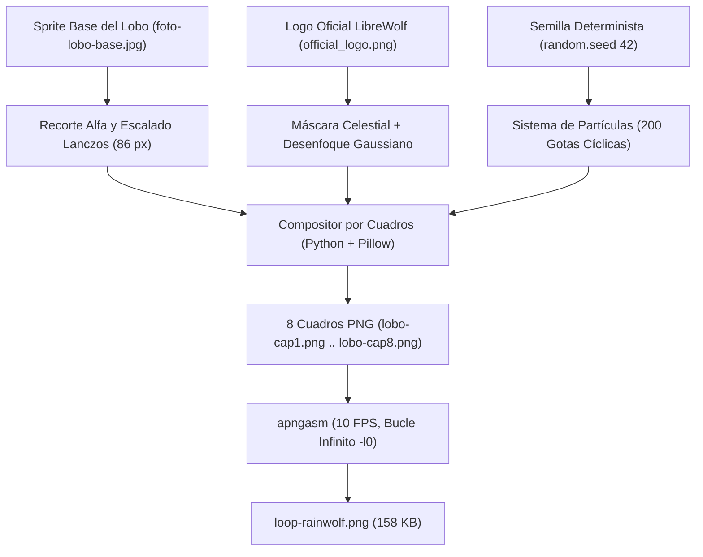

> *Portal oficial de extensiones y temas para Firefox: [Mozilla Add-ons (AMO)](https://addons.mozilla.org/).*
{: .prompt-info}

Hace unas horas recibí la notificación oficial del portal de desarrolladores de Mozilla: mi nuevo tema animado, **Pixel LibreWolf**, fue aprobado y publicado en [Mozilla Add-ons (AMO)](https://addons.mozilla.org/en-US/firefox/addon/animated-librewolf-pixel/). Simultáneamente, la actualización mayor de mi primer tema, **Pixelcat** (v1.5.0), completó su proceso de revisión y despliegue automático.

Crear un tema para el navegador parece, a simple vista, una tarea trivial de diseño. Sin embargo, cuando decides que la cabecera no sea una imagen estática ni un GIF comprimido con aberraciones de color, sino una animación **pixel-art fluida en bucle infinito mediante APNG** acoplada a la especificación **Manifest V3** de Gecko, el proyecto se convierte en un ejercicio fascinante de diseño de sprites, matemáticas procedimentales de partículas y automatización de empaquetado.

En este artículo comparto mi motivación personal para construir estos temas, cómo diseñé y programé las animaciones cuadro por cuadro, y el pipeline de ingeniería que monté en mi repositorio [`0gerardo0/animated-firefox-theme`](https://github.com/0gerardo0/animated-firefox-theme) para automatizar los lanzamientos.

{: .shadow .rounded }
*Banner animado de Pixel LibreWolf: 8 cuadros en bucle infinito mediante APNG nativo (900x100 px).*

---

## 1. La Motivación: Identidad Artesanal en la Trinchera de la Web Abierta

En un ecosistema dominado de forma aplastante por el motor Chromium/Blink, mantener vivos navegadores basados en **Gecko** como **Firefox** y su derivado centrado en privacidad, **LibreWolf**, es una postura tanto técnica como ética.

Uso LibreWolf como mi navegador principal debido a su eliminación estricta de telemetría, aislamiento de cookies (*Total Cookie Protection*) y configuración anti-huella digital por defecto. No obstante, esa misma naturaleza orientada a la seguridad extrema le confiere una experiencia visual inicial austera, fría y monótona.

Muchos usuarios resuelven esto aplicando modificaciones profundas con `userChrome.css`. Aunque `userChrome.css` ofrece un control granular absoluto, tiene tres desventajas críticas:
1. Se rompe con frecuencia cuando Mozilla altera el árbol del DOM interno de la interfaz en actualizaciones mayores de Firefox.
2. Exige activar `toolkit.legacyUserProfileCustomizations.stylesheets` en `about:config`, aumentando la superficie de fricción técnica.
3. No es accesible para usuarios comunes que solo buscan una experiencia estética cuidada sin compilar ni tocar archivos internos del perfil.

Mi objetivo fue diferente: **diseñar temas ligeros y nativos bajo el estándar oficial WebExtensions Theme API**, basados en la calidez del pixel-art, y publicarlos directamente en la tienda oficial de Mozilla. Quería que cualquier usuario pudiera instalar una pieza de arte digital con un solo clic, con firmas criptográficas válidas de Mozilla y actualizaciones automáticas transparentes.

## 2. ¿Por qué APNG y no GIF?

La decisión técnica sobre el formato de imagen fue determinante. Tradicionalmente, las animaciones sencillas en la web se asociaban a archivos `.gif`. Sin embargo, para un tema de navegador moderno, GIF es un formato técnicamente inviable:

| Característica | GIF (Graphics Interchange Format) | APNG (Animated Portable Network Graphics) |
| :--- | :--- | :--- |
| **Profundidad de Color** | 8 bits indexados (máximo 256 colores en paleta global) | **24 bits TrueColor (16.7 millones de colores)** |
| **Canal Alfa (Transparencia)** | 1 bit booleano (píxel 100% transparente o 100% opaco) | **Canal alfa real de 8 bits (256 niveles de opacidad)** |
| **Bordes y Suavizado** | Halos dentados (*fringing*) sobre fondos de distinto color | Transiciones y difuminados suaves integrados en la GPU |
| **Soporte en Gecko** | Universal | **Nativo en Firefox desde la versión 3.0 (2008)** |
| **Compresión de Cuadros** | Compresión LZW básica | **Algoritmo Deflate con chunks `fcTL` y `fdAT` diferenciales** |

En un banner donde coexisten gotas de lluvia semitransparentes, resplandores celestiales y degradados continuos de cielo azul cian, el GIF genera un tramado (*dithering*) ruidoso y antiestético. Con **APNG**, cada cuadro mantiene transparencia real de 8 bits y compresión sin pérdidas.

---

## 3. La Creación del Pixel-Art y la Lógica de Animación

Diseñar una animación para la cabecera de un navegador tiene su maña: el lienzo tiene apenas 100 píxeles de alto (`theme_frame`) y se estira horizontalmente según el monitor. Como la izquierda y el centro de la interfaz están ocupados por los botones de navegación, las pestañas y la barra de direcciones (*AwesomeBar*), el punto focal del pixel-art tiene que vivir cargado hacia la derecha.

La forma de resolver la posición no fue con fórmulas mágicas ni cálculos geométricos en frío: fue **puro tanteo y prueba y error**. Colocar el sprite, cargarlo en el navegador, ver que la barra de direcciones o los botones no lo taparan, empujarlo unos píxeles más a la derecha y volver a probar hasta dar con el punto exacto donde la ilustración respira con naturalidad.

Mis dos temas requirieron metodologías de trabajo distintas pero complementarias:

### A. Pixelcat: Composición por Capas en GIMP

Para **Pixelcat** (`animated-butterfly-pixelcat`), diseñé la escena buscando una atmósfera cálida y relajante: un gato contemplando la brisa mientras mariposas revolotean en el horizonte.

{: .shadow .rounded }
*Banner animado de Pixelcat: 7 cuadros ensamblados a 900x100 px con paleta pastel y viento continuo.*

1. **Estructura en GIMP (`.xcf`):** Modelé la animación en archivos de proyecto independientes (`gatito-cap1.xcf`, `gatito-cap2.xcf`, etc.).
2. **Animación en vaivén simétrico:** Para garantizar que el aleteo de las mariposas y el movimiento del pelaje no dieran saltos temporales, generé una secuencia directa (`cap1` $\to$ `cap2` $\to$ `cap3` $\to$ `cap4`) seguida de una secuencia invertida (`cap3-reverse` $\to$ `cap2-reverse`), cerrando un ciclo perfecto de 7 cuadros.
3. **Control de paleta:** Mantuve tonos tierra y verdes esmeralda suaves, garantizando que el texto de las pestañas en color negro tuviera un ratio de contraste superior a 7:1 (WCAG AAA).

---

### B. Pixel LibreWolf: El Reto Técnico de la Lluvia Procedimental

Admito que, visto desde afuera, lo que hice para **Pixel LibreWolf** (`animated-librewolf-pixel`) roza la sobreingeniería deliberada: ¿quién se pone a programar álgebra vectorial con NumPy, matrices de desenfoque y partículas en toroides solo para animar un banner de navegador? 

Pero esa era precisamente la gracia y el reto técnico que me propuse. En lugar de pasarme horas peleando con el ratón en un editor gráfico intentando colocar gotas a mano (lo que inevitablemente produce patrones repetitivos o saltos toscos al reiniciar el ciclo), preferí automatizar la física y la composición de los fotogramas en mi entorno local mediante un script en Python utilizando **NumPy** y **Pillow**. Si iba a crear el tema de LibreWolf, quería que fuera impecable.



#### 1. Aislamiento del Sprite y Marca de Agua Celestial
El sprite del lobo se extrae eliminando el fondo mediante distancia euclidiana de color en espacio RGB con NumPy, redimensionándolo mediante interpolación Lanczos para ajustarlo con precisión a 86 píxeles de altura:

```python
# Muestreo y extracción de fondo en espacio vectorial
bg_color = np.array([142.0, 221.0, 228.0])
dist = np.sqrt(np.sum((arr[:, :, :3].astype(float) - bg_color)**2, axis=2))
arr[dist < 28, 3] = 0  # Transparencia total para el fondo
```

Para el cielo, aislé la silueta del lobo del logo oficial de LibreWolf y le apliqué una pulsación cósmica modular: la opacidad oscila suavemente entre el 18% y el 24% a lo largo de los cuadros, tratada con un filtro `ImageFilter.GaussianBlur(0.9)`.

#### 2. Sistema de Partículas Cíclico en Toroides
La lluvia utiliza 200 partículas con semilla determinista (`seed = 42`). Para que el bucle de 8 cuadros sea continuo sin que las gotas desaparezcan o salten bruscamente, las coordenadas espaciales se calculan con aritmética modular en un toroide bidimensional:

```python
step_x = 4
step_y = 12
for gx, gy, length, alpha in RAIN_SYSTEM:
    # Coordenadas cíclicas que envuelven el lienzo de 900x100
    cur_x = (gx + frame_idx * step_x) % (WIDTH + 60) - 30
    cur_y = (gy + frame_idx * step_y) % (HEIGHT + 40) - 20
    
    draw.line(
        [(cur_x, cur_y), (cur_x + length // 2, cur_y + length)],
        fill=(255, 255, 255, alpha),
        width=1
    )
    
    # Salpicaduras dinámicas sobre la roca en el suelo
    if cur_y >= HEIGHT - 10 and (gx + frame_idx) % 2 == 0:
        draw.point((cur_x, HEIGHT - 2), fill=(240, 250, 255, 200))
```

Añadí además una sutil modulación vertical en el sprite (`breath_offset = [0, -1, -1, -1, 0, 0, 0, 0]`) para simular la respiración del lobo en la roca, y un destello cian puro en los cuadros 2 y 3 sobre el ojo del animal.

#### 3. Ensamblado del APNG con `apngasm`
Con los 8 cuadros generados (`lobo-cap1.png` a `lobo-cap8.png`), un script en Bash invoca la utilidad de bajo nivel `apngasm` para compilar el archivo binario final a 10 cuadros por segundo:

```bash
#!/usr/bin/env bash
set -euo pipefail

# 8 cuadros, delay de 1/10 de segundo (10 FPS), bucle infinito (-l0)
apngasm loop-rainwolf.png lobo-cap*.png 1 10 -l0
```

El resultado es un archivo de apenas **158 KB**, perfectamente optimizado para cargarse al instante en memoria de vídeo sin penalizar el rendimiento del navegador.

---

## 4. La Arquitectura del Tema: Manifest V3 y el Desafío del Contraste

Bajo la especificación de temas de Gecko en Manifest V3, el archivo [`manifest.json`](https://github.com/0gerardo0/animated-firefox-theme/blob/master/themes/pixellibrewolf/manifest.json) define tanto los recursos multimedia como la matriz de color de los componentes del navegador:

```json
{
  "name": "animated|librewolfpixelby0gerardo0",
  "manifest_version": 3,
  "version": "1.0.0",
  "theme": {
    "images": {
      "theme_frame": "loop-rainwolf.png"
    },
    "colors": {
      "frame": "rgba(0, 172, 255, 1.0)",
      "toolbar": "rgba(255, 255, 255, 0.35)",
      "toolbar_text": "rgb(2, 6, 23)",
      "tab_text": "rgb(2, 6, 23)",
      "tab_background_text": "rgb(2, 6, 23)",
      "toolbar_field": "rgba(255, 255, 255, 0.90)",
      "toolbar_field_text": "rgb(2, 6, 23)",
      "tab_line": "rgb(0, 102, 204)",
      "popup": "rgba(240, 248, 255, 0.95)",
      "popup_text": "rgb(2, 6, 23)",
      "popup_border": "rgba(0, 172, 255, 0.70)",
      "popup_highlight": "rgba(180, 235, 255, 0.95)",
      "popup_highlight_text": "rgb(2, 6, 23)",
      "button_background_hover": "rgba(255, 255, 255, 0.40)",
      "button_background_active": "rgba(0, 153, 230, 0.60)"
    }
  },
  "browser_specific_settings": {
    "gecko": {
      "id": "pixellibrewolf-theme@gerardo0"
    }
  },
  "icons": {
    "48": "icon.svg",
    "96": "icon.svg"
  }
}
```

### El Dolor de UX en la Vida Real: La Actualización v1.5.0 de Pixelcat

Un error muy común al diseñar temas es probarlos únicamente mirando la barra de pestañas y olvidar los estados interactivos del navegador. 

En la versión 1.4.0 de Pixelcat descubrí un problema crítico de usabilidad: al escribir en la barra de direcciones, el menú desplegable de sugerencias de búsqueda utilizaba una selección translúcida (`popup_highlight: rgba(255, 215, 154, 0.6)`). Al pasar el cursor sobre una sugerencia, la mezcla del color de realce con el fondo volvía el texto casi ilegible.

Para la versión **1.5.0**, rediseñé la paleta de interacción del popup:
- Elevé la opacidad de `popup_highlight` de **0.60 a 0.95** (`rgba(255, 195, 120, 0.95)`).
- Modifiqué `popup_highlight_text` a un marrón oscuro profundo (`rgb(60, 25, 0)`).
- Sincronicé formalmente el identificador canónico `browser_specific_settings.gecko.id` con el asignado por AMO (`pixelcat-theme@gerardo0`) para que los usuarios existentes recibieran el parche sin conflictos de firma.

---

## 5. Automatización: Empaquetado con Bash y CI/CD

Mozilla Add-ons impone reglas estrictas para los archivos `.xpi` (que internamente son archivos ZIP con cabeceras específicas). Si comprimes la carpeta del tema incluyendo el directorio contenedor (por ejemplo, `pixelcat/manifest.json`), el validador automático de AMO rechaza el paquete al instante porque exige que `manifest.json` resida estrictamente en la raíz del archivo ZIP.

Para evitar errores humanos y pruebas manuales tediosas, creé un script de automatización en Bash ([`package.sh`](https://github.com/0gerardo0/animated-firefox-theme/blob/master/package.sh)):

```bash
#!/usr/bin/env bash
set -euo pipefail

ROOT_DIR="$(cd "$(dirname "${BASH_SOURCE[0]}")" && pwd)"
THEMES_DIR="$ROOT_DIR/themes"
DIST_DIR="$ROOT_DIR/dist"

package_theme() {
    local theme_name="$1"
    local theme_path="$THEMES_DIR/$theme_name"
    local manifest="$theme_path/manifest.json"

    # 1. Validar sintaxis JSON estricta antes de compilar
    if ! python3 -m json.tool "$manifest" > /dev/null 2>&1; then
        echo "Error: $manifest contiene JSON inválido" >&2
        return 1
    fi

    mkdir -p "$DIST_DIR"
    local output_file="$DIST_DIR/${theme_name}.xpi"
    rm -f "$output_file"

    # 2. Empaquetar desde dentro del directorio para situar manifest.json en la raíz
    (
        cd "$theme_path"
        zip -q -r -FS "$output_file" . -x ".*" -x "*.bak" -x "*~"
    )

    echo "✓ Empaquetado exitoso: dist/${theme_name}.xpi"
}
```

El parámetro `-FS` (*File Sync*) de `zip` garantiza que el `.xpi` resultante sea reproducible e idéntico a los activos vigentes, excluyendo archivos ocultos del sistema de archivos.

### Despliegue Continuo con GitHub Actions

Para la distribución de paquetes directos fuera de AMO, integré un flujo en GitHub Actions ([`.github/workflows/release.yml`](https://github.com/0gerardo0/animated-firefox-theme/blob/master/.github/workflows/release.yml)). Cada vez que publico una etiqueta de versión en Git:

```bash
git tag v2.0.0
git push origin v2.0.0
```

El runner de GitHub ejecuta `./package.sh --all`, compila los paquetes `.xpi` limpios y los adjunta como binarios descargables en la sección de Releases del repositorio. De este modo, quienes prefieren no utilizar la tienda de extensiones pueden descargar el `.xpi` e instalarlo arrastrándolo directamente sobre la ventana de Firefox o LibreWolf.

---

## 6. Pruebas Locales Inmediatas con `about:debugging`

Uno de los grandes aciertos de la arquitectura de Gecko es su ciclo de desarrollo en caliente. Para probar cualquier cambio en los colores o en los fotogramas del APNG sin empaquetar ni firmar:

1. Ingreso a `about:debugging#/runtime/this-firefox` en la barra de direcciones.
2. Hago clic en **"Cargar complemento temporal..."** (*Load Temporary Add-on...*).
3. Selecciono el archivo `manifest.json` del directorio de trabajo correspondiente (`themes/pixellibrewolf/manifest.json`).
4. La interfaz del navegador muta instantáneamente con la animación activa y los contrastes aplicados.

---

## Conclusiones

Crear estos temas para Firefox y LibreWolf ha sido una experiencia gratificante en la intersección entre el arte digital y la ingeniería de software. Demuestra que personalizar el entorno de trabajo diario no requiere sobrecargar el sistema ni depender de capas frágiles: con un entendimiento claro de los estándares abiertos (**APNG**, **WebExtensions** y **Gecko Theme API**), es posible inyectar identidad y detalle visual a una herramienta esencial conservando la ligereza y el respeto por los recursos del sistema.

Ambos temas se encuentran disponibles para su instalación y código abierto:

* **Pixel LibreWolf:** [Instalar en Firefox Add-ons](https://addons.mozilla.org/en-US/firefox/addon/animated-librewolf-pixel/) | Código en [`themes/pixellibrewolf`](https://github.com/0gerardo0/animated-firefox-theme/tree/master/themes/pixellibrewolf).
* **Pixelcat:** [Instalar en Firefox Add-ons](https://addons.mozilla.org/en-US/firefox/addon/animated-butterfly-pixelcat/) | Código en [`themes/pixelcat`](https://github.com/0gerardo0/animated-firefox-theme/tree/master/themes/pixelcat).
* **Repositorio Completo y Pipeline:** [`0gerardo0/animated-firefox-theme`](https://github.com/0gerardo0/animated-firefox-theme).

---

## Referencias

* **Mozilla Developer Network (MDN).** *Theme WebExtensions API Reference.* <https://developer.mozilla.org/en-US/docs/Mozilla/Add-ons/WebExtensions/manifest.json/theme>
* **Mozilla Developer Network (MDN).** *APNG (Animated Portable Network Graphics) Specification.* <https://developer.mozilla.org/en-US/docs/Mozilla/Tech/APNG>
* **LibreWolf Community.** *LibreWolf Browser: A fork of Firefox focused on privacy, security and freedom.* <https://librewolf.net/>
* **Mozilla Extension Workshop.** *Publishing your extension on AMO.* <https://extensionworkshop.com/documentation/publish/>
* **W3C.** *Web Content Accessibility Guidelines (WCAG) 2.1: Contrast (Minimum).* <https://www.w3.org/WAI/WCAG21/Understanding/contrast-minimum.html>
