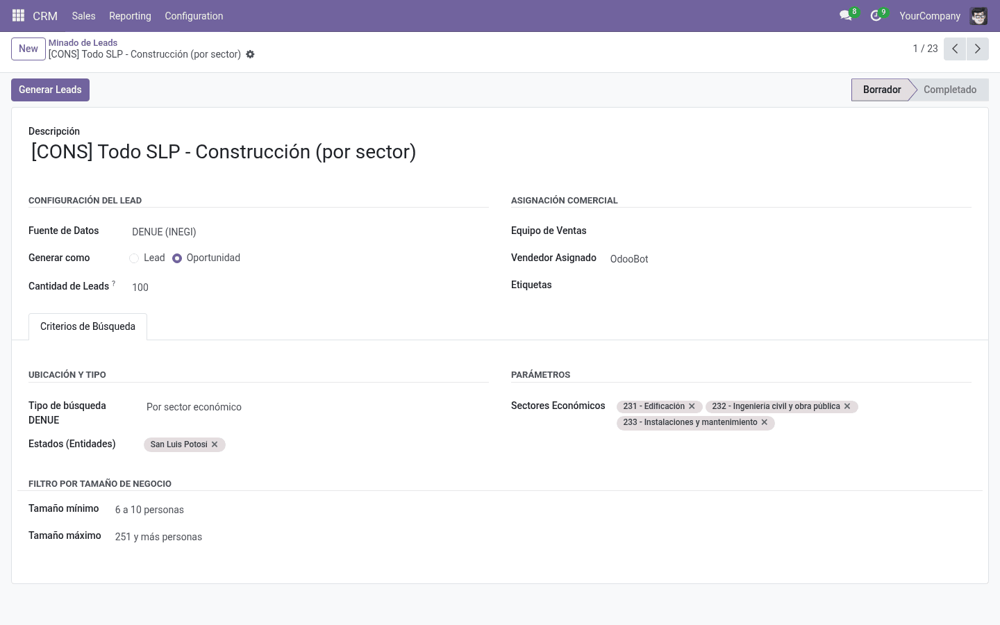
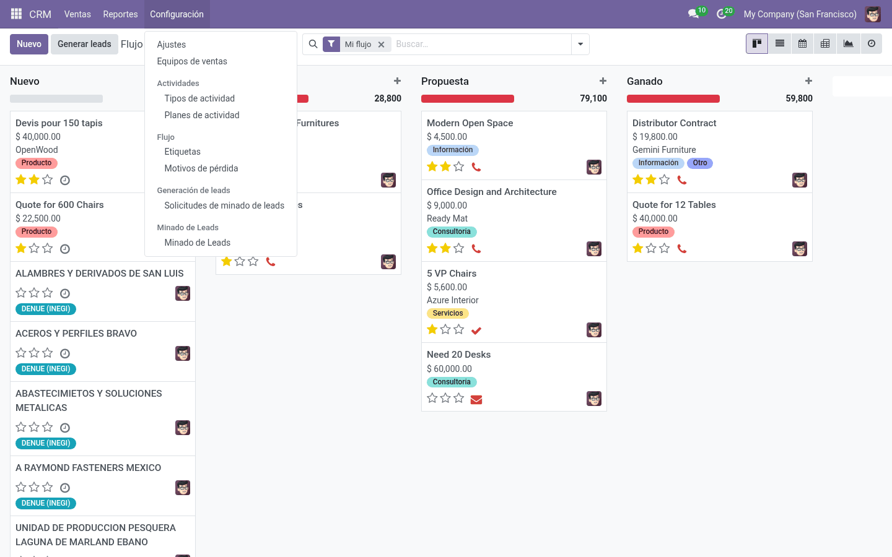

Las herramientas de prospección comercial de pago (Apollo, ZoomInfo o los paquetes de créditos IAP en Odoo) funcionan bien y traen buenos datos, pero sus planes van de los 50 a más de 3,000 dólares mensuales. Para una operación local o cuando quieres armar una base masiva de empresas en México, pagar ese dineral en créditos no tiene mucho sentido. El INEGI ya tiene publicado el **DENUE (Directorio Estadístico Nacional de Unidades Económicas)**: un directorio oficial con millones de establecimientos registrados en todo el país, clasificados por actividad económica, ubicación y tamaño.

La información está ahí y es pública, así que el reto era conectarla directo a Odoo 18 sin intermediarios ni costos recurrentes. Para resolverlo en [Mando de Datos (MADA)](https://madamexico.me), desarrollamos [`crm-lead-fetcher`](https://github.com/MADA-Mando-de-Datos/crm-lead-fetcher), un módulo open-source que extrae registros del DENUE y los convierte en leads calificados dentro del CRM.

Esta es la primera parte del desarrollo. Aquí documento cómo lidiar con las particularidades de la API del INEGI y cómo estructurar el módulo en Odoo para no amarrarse a una sola fuente de datos.

---

## Las rarezas de la API del DENUE

La documentación del INEGI te da una idea general, pero cuando empiezas a tirar peticiones HTTP reales te topas con comportamientos poco comunes en servicios REST actuales.

### 1. Parámetros posicionales en la URL

En lugar de usar query params tradicionales (`?actividad=restaurante&estado=24`), la API del DENUE te exige meter los parámetros directamente en los segmentos de la ruta:

```http
GET /app/api/denue/v1/consulta/BuscarEntidad/{condicion}/{entidad}/{ini}/{fin}/{token} HTTP/1.1
Host: www.inegi.org.mx
```

Esto vuelve delicado el armado de la URL:
- La posición exacta define qué parámetro estás pasando.
- Si la `{condicion}` lleva comas o palabras compuestas (por ejemplo `"talleres mecánicos"` o `"restaurantes"` en San Luis Potosí, clave `24`), la codificación normal de URLs con `quote_plus` (que mete `+`) rompe el endpoint. Hay que codificar preservando comas:

```python
from urllib.parse import quote

def _q(text):
    return quote(str(text), safe=',')
```

### 2. Respuestas HTML 404 en vez de JSON

Si mandas un parámetro fuera de rango, una ruta mal armada o un token revocado, el servidor del INEGI no te devuelve un JSON con `{ "error": "not_found" }`. Devuelve una página HTML completa de error de IIS/ASP.NET.

Si intentas hacer directamente `response.json()`, Python truena con `JSONDecodeError`. Para no romper el flujo del CRM y entender qué pasó, capturo la respuesta y valido el contenido antes de parsear:

```python
import requests
import time
from ..exceptions import LeadSourceConnectionError, LeadSourceDataError

def _make_request(self, url):
    last_error = None
    for attempt in range(self.MAX_RETRIES):
        try:
            resp = requests.get(url, timeout=self.REQUEST_TIMEOUT)

            if resp.status_code == 404:
                raise LeadSourceDataError("El endpoint de DENUE devolvió 404.")

            if 'text/html' in resp.headers.get('Content-Type', '').lower():
                raise LeadSourceDataError("INEGI devolvió HTML en lugar de JSON.")

            return resp.json()

        except requests.exceptions.Timeout as e:
            last_error = LeadSourceConnectionError(f"Timeout al conectar con INEGI: {e}")
        except requests.exceptions.RequestException as e:
            last_error = LeadSourceConnectionError(f"Falla de red con DENUE: {e}")
        except ValueError as e:
            raise LeadSourceDataError(f"Respuesta no válida como JSON: {e}")

        time.sleep(self.RETRY_BACKOFF * (attempt + 1))

    raise last_error
```

### 3. Enmascarar el token en logs

Como el token de autenticación viaja en la misma URL:

```text
.../BuscarEntidad/restaurantes/24/1/50/a1b2c3d4-xxxx-xxxx-xxxx-xxxxxxxxxxxx
```

Cualquier excepción no capturada o log de red que imprima la URL va a exponer el token en `ir.logging` o en el chatter de Odoo. Para que no quede visible a usuarios del sistema ni en reportes de error, aplico una máscara antes de guardar los mensajes en el registro:

```python
def mask_api_tokens(message, token):
    if not token or not message:
        return message
    clean_token = token.strip()
    if len(clean_token) > 8:
        masked = f"{clean_token[:4]}...{clean_token[-4:]}"
    else:
        masked = "***"
    return message.replace(clean_token, masked)
```

---

## Mapeo de datos: Estados y Estratos

Los datos que devuelve el INEGI vienen con nomenclaturas que Odoo no entiende directamente.

### Claves de estado (Entidades)

El INEGI maneja las entidades federativas con claves numéricas de dos dígitos: `01` para Aguascalientes, `09` para Ciudad de México, `24` para San Luis Potosí, etc. 

En Odoo los estados viven en `res.country.state`. Para conectarlos sin hacer consultas lentas en cada petición, creé un catálogo intermedio `crm.denue.entidad` precargado con las claves del INEGI vinculadas a cada estado en Odoo:

```xml
<record id="entidad_24" model="crm.denue.entidad">
    <field name="code">24</field>
    <field name="name">San Luis Potosí</field>
</record>
```

### Estratos de personal

El DENUE no reporta el número exacto de empleados por establecimiento por cuestiones estadísticas; usa rangos del 1 al 7. Mapear estos rangos es clave para no traer micro-negocios si lo que buscas son empresas medianas o grandes:

```python
ESTRATO_LABELS = {
    1: '0 a 5 personas',
    2: '6 a 10 personas',
    3: '11 a 30 personas',
    4: '31 a 50 personas',
    5: '51 a 100 personas',
    6: '101 a 250 personas',
    7: '251 y más personas',
}
```


_Formulario de solicitud en Odoo 18: configuración de sectores económicos SCIAN, entidad federativa (San Luis Potosí) y filtros de estratos de personal ocupado._

---

## Desacoplar las fuentes en Odoo (para no llenarse de if/else)

Un error común al hacer integraciones en Odoo es meter toda la lógica de la API dentro del modelo del wizard. El problema de hacer eso es que cuando después quieres agregar Google Places o Yelp, terminas con un archivo gigante lleno de condicionales.

Para evitarlo, separé el diseño en tres piezas usando `AbstractModel`.

### 1. El contrato base (`lead.source`)

Una clase abstracta que define los métodos que cualquier proveedor de leads debe cumplir:

```python
from odoo import models, fields

class LeadSource(models.AbstractModel):
    _name = 'lead.source'
    _description = 'Fuente de datos de leads (abstracta)'

    source_key = fields.Char(string='Clave técnica', required=True)
    name = fields.Char(string='Nombre', required=True)

    def search(self, filters, max_records):
        raise NotImplementedError()

    def test_connection(self):
        raise NotImplementedError()

    def build_filters(self, wizard):
        return {}

    def record_to_lead_vals(self, record, lead_type, team_id, user_id, tag_ids, request_id):
        raise NotImplementedError()
```

### 2. El registro central (`lead.source.registry`)

Funciona como un despachador. Cuando el usuario selecciona una fuente en la interfaz, el registro busca el modelo correspondiente en el entorno de Odoo:

```python
from odoo import models, api

class LeadSourceRegistry(models.AbstractModel):
    _name = 'lead.source.registry'
    _description = 'Registro de fuentes de leads'

    @api.model
    def _get_sources(self):
        return {
            'denue': 'lead.source.denue',
            'yelp': 'lead.source.yelp',
            'google': 'lead.source.google',
        }

    @api.model
    def get_source(self, source_key):
        sources = self._get_sources()
        model_name = sources.get(source_key)
        if not model_name:
            raise ValueError(f"Fuente de datos desconocida: {source_key}")
        return self.env[model_name]
```

### 3. La solicitud (`crm.lead.request`)

El modelo transaccional donde el usuario configura qué buscar y cuántos prospectos quiere. Su ciclo de vida es directo:

- **Borrador (`draft`)**: El usuario define filtros y cantidad.
- **Completado (`done`)**: La fuente buscó, se transformaron los datos y se crearon los leads.
- **Error (`error`)**: Se guarda el mensaje saneado sin el token expuesto.

El método que ejecuta la minería solo delega a la fuente activa:

```python
def action_mine_leads(self):
    self.ensure_one()
    source = self.env['lead.source.registry'].get_source(self.source_key)

    source.validate_filters(self)
    filters = source.build_filters(self)

    raw_records = source.search(filters, self.lead_number)
    filtered_records = source.post_filter(raw_records, self)

    leads = self._create_leads_from_response(filtered_records)

    self.write({
        'state': 'done',
        'error_msg': False,
    })
    return self.action_view_leads()
```


_Prospectos minados desde el censo del DENUE integrados directamente en el flujo de ventas de Odoo con la etiqueta de origen identificada._

---

## Conclusiones

Conectar el censo del DENUE directamente a Odoo 18 resuelve la prospección masiva de empresas en México sin depender de créditos por lead que encarecen la operación comercial. Sin embargo, las particularidades de una API gubernamental antigua (parámetros estrictamente posicionales en el path, respuestas HTML 404 y credenciales expuestas en la URL) exigen tratar al cliente HTTP como un componente crítico de infraestructura.

Separar la lógica mediante `AbstractModel` y un registro dinámico permite que el módulo crezca hacia otras fuentes como Google Places o Yelp sin convertir los modelos del CRM en un espagueti de condicionales. En la siguiente entrega abordaremos la reconciliación de estos datos: el algoritmo de huella digital para deduplicar empresas entre fuentes distintas, la optimización por lotes para no ahogar el ORM y la protección anti-SSRF al enriquecer correos desde las páginas web de los prospectos.

---

## Referencias

* **Mando de Datos (MADA).** *Módulo CRM Lead Fetcher para Odoo 18 (DENUE, Yelp & Google Places).* Repositorio oficial en GitHub y documentación de arquitectura. [github.com/MADA-Mando-de-Datos/crm-lead-fetcher](https://github.com/MADA-Mando-de-Datos/crm-lead-fetcher) / [madamexico.me](https://madamexico.me).
* **Instituto Nacional de Estadística y Geografía (INEGI).** *Directorio Estadístico Nacional de Unidades Económicas (DENUE) — Especificación Técnica de la API de Consulta v1.* Documentación oficial de endpoints posicionales, claves de entidad y catálogo SCIAN. [inegi.org.mx/servicios/api_denue.html](https://www.inegi.org.mx/servicios/api_denue.html).
* **Odoo S.A.** *Odoo 18.0 Developer Documentation: Models and the ORM (`models.AbstractModel` & `api.model`).* Arquitectura de modelos abstractos y despacho polimórfico en el framework backend de Odoo. [odoo.com/documentation/18.0/developer/reference/backend/orm.html](https://www.odoo.com/documentation/18.0/developer/reference/backend/orm.html).
* **Odoo S.A.** *Odoo CRM & Lead Mining Architecture (`crm_iap_mine`).* Estructura de solicitudes transaccionales y ciclo de vida de prospectos comerciales. [github.com/odoo/odoo/tree/18.0/addons/crm_iap_mine](https://github.com/odoo/odoo/tree/18.0/addons/crm_iap_mine).
* **R. Fielding, J. Reschke.** *Hypertext Transfer Protocol (HTTP/1.1): Semantics and Content.* Internet Engineering Task Force (IETF), RFC 7231 (Sección 6.5.4: 404 Not Found & Content-Type Negotiation). [rfc-editor.org/rfc/rfc7231](https://www.rfc-editor.org/rfc/rfc7231).
* **T. Berners-Lee, R. Fielding, L. Masinter.** *Uniform Resource Identifier (URI): Generic Syntax.* IETF, RFC 3986 (Sección 2.2: Reserved Characters and Percent-Encoding in Path Segments). [rfc-editor.org/rfc/rfc3986](https://www.rfc-editor.org/rfc/rfc3986).
* **Python Software Foundation.** *urllib.parse — Parse URLs into components (`urllib.parse.quote`).* Documentación oficial de Python 3.11 sobre codificación segura de rutas URI. [docs.python.org/3/library/urllib.parse.html](https://docs.python.org/3/library/urllib.parse.html).
