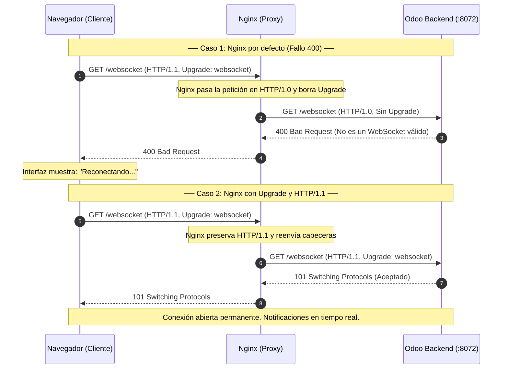

> *Fotografía de portada: [Jordan Harrison](https://unsplash.com/@jouwdan) en [Unsplash](https://unsplash.com/photos/40XgDxBfYXM) (Licencia Unsplash).*
{: .prompt-info}

Durante el despliegue de instancias de Odoo 18 en mi servidor con Debian 12, me topé con un comportamiento molesto en el navegador: cada 60 segundos aparecía un banner en la esquina superior que decía *"Reconectando..."*. Además, al instalar o actualizar cualquier módulo desde la lista de Aplicaciones, la pantalla se quedaba congelada; la barra de progreso nunca terminaba de responder en la interfaz web, aunque en el servidor el proceso terminaba sin problemas en segundo plano.

Al revisar los registros de acceso en `/var/log/odoo/odoo.log` y en Nginx, encontré la causa:

```text
127.0.0.1 - - [01/Nov/2026 02:10:15] "GET /websocket?version=18.0-7 HTTP/1.0" 400 -
```

Nginx le estaba mandando la petición a Odoo en HTTP/1.0 y Odoo respondía con un error `400 Bad Request`.

El problema no estaba en el código de Odoo ni en la base de datos PostgreSQL, sino en cómo Nginx maneja las peticiones de WebSocket por defecto cuando no le indicamos cómo pasar las cabeceras de red. En este artículo explico por qué ocurre esto con Odoo 17 y 18, cómo funciona la negociación del WebSocket y la configuración que dejé lista en Nginx para solucionarlo.

---

## 1. De Longpolling a WebSocket Nativo

Para entender el error 400, hay que ver cómo cambió Odoo internamente para avisarle al navegador cuando algo pasa en el sistema (el bus de mensajería `bus.bus`).

En versiones anteriores (Odoo 16 hacia atrás), el sistema usaba **HTTP Longpolling**. El navegador mandaba una petición HTTP normal al endpoint `/longpolling/poll` en el puerto `8072` (controlado por `gevent`). La conexión se quedaba abierta esperando a que cayera un mensaje o se cumpliera un tiempo límite, momento en el que se cerraba y el navegador abría otra petición igual. Como eran peticiones HTTP comunes y corrientes, cualquier proxy inverso estándar las pasaba sin problemas.

```
Mecanismo en Odoo 16 y anteriores:
Navegador ───[ POST /longpolling/poll ]───> Nginx ───[ HTTP/1.0 ]───> Odoo:8072
Navegador <───[ 200 OK (Mensaje JSON) ]─── Nginx <───[ HTTP/1.0 ]─── Odoo:8072
(La conexión se cierra y el navegador abre otra)
```

A partir de Odoo 17 y en Odoo 18, la arquitectura cambió a **WebSockets nativos** a través del endpoint `/websocket`.

En lugar de estar abriendo y cerrando peticiones HTTP a cada rato, el navegador abre una sola conexión permanente (*full-duplex*). Una vez conectada, Odoo y el navegador pueden mandarse datos al instante sin la sobrecarga de reenviar cabeceras HTTP en cada notificación.

El detalle está en que un WebSocket no arranca como un socket normal: empieza como una petición HTTP que solicita una elevación de protocolo (*Upgrade*).

---

## 2. El Handshake HTTP 101 y las Cabeceras Hop-by-Hop

El estándar **RFC 6455** define que para iniciar un WebSocket, el cliente manda una petición HTTP/1.1 pidiendo el cambio de protocolo con estas cabeceras:

```http
GET /websocket?version=18.0-7 HTTP/1.1
Host: erp.example.com
Upgrade: websocket
Connection: Upgrade
Sec-WebSocket-Key: dGhlIHNhbXBsZSBub25jZQ==
Sec-WebSocket-Version: 13
```

*(Nota técnica: el valor `dGhlIHNhbXBsZSBub25jZQ==` es el ejemplo oficial del RFC 6455; al decodificarlo de Base64 significa literalmente "the sample nonce", no es ninguna clave privada).*

Si el servidor acepta la conexión, responde con el código `101 Switching Protocols`:

```http
HTTP/1.1 101 Switching Protocols
Upgrade: websocket
Connection: Upgrade
Sec-WebSocket-Accept: s3pPLMBiTxaQ9kYGzzhZRbK+xOo=
```

A partir de ese segundo, la petición HTTP termina y la conexión TCP queda abierta para transferir datos en ambas direcciones.

El cálculo que hace el backend para confirmar la conexión toma la clave del cliente, le pega un identificador fijo de la especificación (`258EAFA5-E914-47DA-95CA-C5AB0DC85B11`), calcula su hash SHA-1 y lo codifica en Base64:

$$\text{Sec-WebSocket-Accept} = \text{Base64}\Big(\text{SHA-1}\big(\text{Sec-WebSocket-Key} \mathbin{\Vert} \text{"258EAFA5-E914-47DA-95CA-C5AB0DC85B11"}\big)\Big)$$

### Por qué Nginx provoca el Error 400

Según el estándar **RFC 7230**, las cabeceras `Upgrade` y `Connection` son cabeceras de salto individual (*hop-by-hop*). Esto significa que están pensadas para una sola conexión directa y que los servidores proxy deben eliminarlas antes de reenviar el tráfico al siguiente punto.

Por defecto, cuando configuramos Nginx con un `proxy_pass` básico:
1. Nginx elimina las cabeceras `Upgrade` y `Connection`.
2. Nginx se comunica con Odoo usando **HTTP/1.0** (que no sabe qué es un WebSocket).

Cuando el proceso de Odoo en el puerto `8072` recibe la petición en `/websocket` en HTTP/1.0 y sin la cabecera `Upgrade: websocket`, no puede abrir el canal y responde de inmediato con:

```http
HTTP/1.0 400 Bad Request
Content-Type: text/plain

Bad Request
```

El navegador ve el 400, cree que se cortó la red y muestra el mensaje de *"Reconectando..."*.

---

## 3. Diagrama: Flujo con Error vs Flujo Corregido

Así se ve el contraste entre dejar Nginx con la configuración por defecto y pasarle los parámetros correctos:



---

## 4. El Timeout de 60 Segundos

Aun cuando el WebSocket conecte bien, hay un segundo problema muy común: las desconexiones periódicas cada 60 segundos.

Por defecto, Nginx tiene este parámetro:

```nginx
proxy_read_timeout 60s;
```

Esto le dice a Nginx que si en 60 segundos el backend no manda datos por esa conexión, la cierre. 

En un sistema como Odoo, un usuario puede estar leyendo un documento o capturando datos sin recibir notificaciones durante un minuto. Si Odoo no manda un paquete de mantenimiento (*ping/pong*) dentro de esos 60 segundos, Nginx corta el socket TCP. El navegador nota el corte y vuelve a intentar conectar.

Por eso es necesario subir `proxy_read_timeout` y `proxy_send_timeout` a un valor alto, como `3600s` (1 hora), para que la conexión no se caiga por inactividad.

---

## 5. Configuración en Nginx

Para resolverlo, definí dos bloques de upstream en Nginx:
* **Puerto `8069` (`odoo_core`):** Para la navegación web normal, vistas, reportes y peticiones RPC.
* **Puerto `8072` (`odoo_chat`):** Para el proceso de eventos y WebSockets.

En el archivo del sitio en `/etc/nginx/sites-available/odoo.conf`:

```nginx
upstream odoo_core {
    server 127.0.0.1:8069;
}

upstream odoo_chat {
    server 127.0.0.1:8072;
}

server {
    listen 443 ssl http2;
    listen [::]:443 ssl http2;
    server_name erp.example.com;

    ssl_certificate     /etc/nginx/ssl/odoo.pem;
    ssl_certificate_key /etc/nginx/ssl/odoo-key.pem;

    access_log /var/log/nginx/odoo_access.log;
    error_log  /var/log/nginx/odoo_error.log;

    client_max_body_size 512M;

    # Cabeceras de seguridad básicas
    add_header X-Frame-Options "SAMEORIGIN" always;
    add_header X-Content-Type-Options "nosniff" always;
    add_header Strict-Transport-Security "max-age=31536000; includeSubDomains" always;

    # ── 1. Bloque WebSocket para Odoo 17 y 18 ───────────────────────────
    location /websocket {
        proxy_pass http://odoo_chat;
        
        # Obligatorio: usar HTTP/1.1 para soportar Upgrade
        proxy_http_version 1.1;
        
        # Pasar las cabeceras de elevación de protocolo
        proxy_set_header Upgrade $http_upgrade;
        proxy_set_header Connection "upgrade";
        
        # Datos del cliente
        proxy_set_header Host $host;
        proxy_set_header X-Real-IP $remote_addr;
        proxy_set_header X-Forwarded-For $proxy_add_x_forwarded_for;
        proxy_set_header X-Forwarded-Proto https;
        
        # Mantener la conexión abierta 1 hora sin cortes
        proxy_read_timeout 3600s;
        proxy_send_timeout 3600s;
        
        # Desactivar buffering para recibir notificaciones al momento
        proxy_buffering off;
    }

    # ── 2. Compatibilidad para longpolling anterior ──────────────────────
    location /longpolling {
        proxy_pass http://odoo_chat;
        proxy_set_header Host $host;
        proxy_set_header X-Real-IP $remote_addr;
        proxy_set_header X-Forwarded-For $proxy_add_x_forwarded_for;
        proxy_set_header X-Forwarded-Proto https;
        proxy_read_timeout 3600s;
    }

    # ── 3. Aplicación principal (ERP web) ────────────────────────────────
    location / {
        proxy_pass http://odoo_core;
        proxy_set_header Host $host;
        proxy_set_header X-Real-IP $remote_addr;
        proxy_set_header X-Forwarded-For $proxy_add_x_forwarded_for;
        proxy_set_header X-Forwarded-Proto https;
        proxy_read_timeout 600s;
    }

    # ── 4. Archivos estáticos ────────────────────────────────────────────
    location ~* ^/(web/assets|web/static)/ {
        proxy_cache_valid 200 60m;
        proxy_buffering on;
        expires 30d;
        proxy_pass http://odoo_core;
    }
}
```

---

## 6. Comprobación de la Conexión

Tras guardar los cambios, verifiqué la sintaxis y recargué Nginx:

```bash
sudo nginx -t && sudo systemctl reload nginx
```

Para probar que el WebSocket responde sin abrir el navegador, usé `curl` mandando las cabeceras de handshake a mano:

```bash
curl -i -N \
  -H "Connection: Upgrade" \
  -H "Upgrade: websocket" \
  -H "Sec-WebSocket-Version: 13" \
  -H "Sec-WebSocket-Key: SGVsbG8sIHdvcmxkIQ==" \
  https://erp.example.com/websocket?version=18.0-7
```

Si la configuración está bien, la primera línea de respuesta debe ser:

```http
HTTP/1.1 101 Switching Protocols
Server: nginx
Connection: upgrade
Upgrade: websocket
```

En el navegador (con F12 en la pestaña **Network** filtrando por **WS**), la petición a `/websocket` debe aparecer en estado `101`, y en la pestaña **Messages** se ven los pings periódicos sin que la conexión se reinicie al minuto. Al instalar un módulo, la interfaz muestra la confirmación al terminar sin quedarse pasmada.

---

## Conclusiones

Este fallo es un ejemplo claro de cómo un problema que parece de la interfaz gráfica en realidad viene de la capa de red del proxy. Con Odoo 17 y 18, Nginx necesita saber explícitamente que `/websocket` no es una página web normal, sino una conexión continua que requiere HTTP/1.1 y tiempos de espera más amplios.

---

## Referencias

* **I. Fette, A. Melnikov.** *The WebSocket Protocol.* Internet Engineering Task Force (IETF), RFC 6455. [rfc-editor.org/rfc/rfc6455](https://www.rfc-editor.org/rfc/rfc6455).
* **R. Fielding, M. Nottingham, J. Reschke.** *Hypertext Transfer Protocol (HTTP/1.1): Message Syntax and Routing.* IETF, RFC 7230 (Sección 6.1: Connection and Hop-by-Hop Headers). [rfc-editor.org/rfc/rfc7230](https://www.rfc-editor.org/rfc/rfc7230).
* **Nginx Documentation.** *WebSocket proxying.* Documentación oficial de Nginx para proxies WebSocket. [nginx.org/en/docs/http/websocket.html](https://nginx.org/en/docs/http/websocket.html).
* **Odoo S.A.** *Odoo Developer Documentation: WebSockets and the Bus Service.* Arquitectura del bus en Odoo 18. [odoo.com/documentation/18.0/developer/reference/backend/websocket.html](https://www.odoo.com/documentation/18.0/developer/reference/backend/websocket.html).
* **Armin Ronacher et al.** *Werkzeug Documentation.* Librería WSGI base de Odoo. [palletsprojects.com/p/werkzeug](https://palletsprojects.com/p/werkzeug/).
