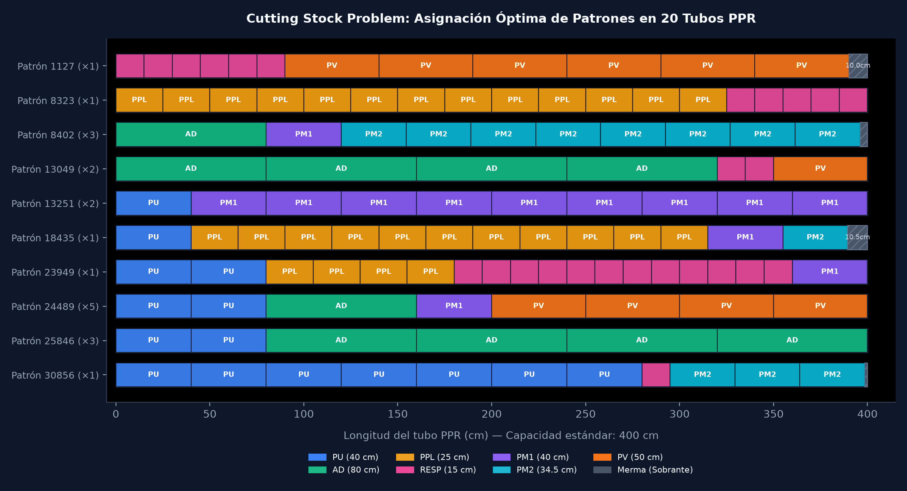

> *Fotografía de portada: [ThisisEngineering](https://unsplash.com/@thisisengineering) en [Unsplash](https://unsplash.com/photos/thisisengineering) (Licencia Unsplash).*
{: .prompt-info}

Hace algún tiempo me ofrecieron un trabajo en una obra para una constructora para fabricar e instalar 72 tomas de agua utilizando tubería de polipropileno copolímero random, conocida comúnmente como PPR, unida mediante termofusión.

En ese momento mi experiencia práctica era principalmente en trabajos de electricista y casi nada en fontanería, y mucho menos sabía termofusionar tubos. Para la primera etapa del trabajo iban a llevar un primer lote de 20 tubos a la obra. La idea que traían los encargados era la habitual en muchas construcciones: comprar tubos al tanteo y cortar piezas a ojo, asumiendo que de 20 tubos saldrían unas 20 tomas o menos, y que tirar retazos a la basura es un costo inevitable.

No me gustaba la idea de trabajar a ciegas. Si iba a hacer el trabajo, quería hacerlo bien en dos partes: aprender a termofusionar con la técnica correcta para que las uniones no fallaran, y calcular exactamente los cortes para aprovechar cada centímetro de tubo sin desperdiciar material.

---

## Aprender el Oficio: Cómo Funciona la Termofusión

Antes de ponerme a programar nada, necesitaba entender cómo se trabaja el material en la práctica. A diferencia de las tuberías de PVC que se pegan con pegamento químico, el PPR se calienta a unos 260 °C con una plancha termofusora usando dados especiales de teflón. 

A esa temperatura el plástico del tubo y del accesorio se derrite lo suficiente para que, al unirlos, se fundan en una sola pieza continua al enfriarse.

```
Tubo PPR ────────┐
                 ├── Calentamiento a 260 °C ──> Unión recta sin girar ──> Enfriamiento
Accesorio PPR ───┘
```

El proceso tiene reglas muy estrictas si no quieres arruinar la instalación:

* Hay una marca exacta hasta donde debe entrar el tubo en el dado. Si lo metes de más, el plástico derretido se acumula por dentro y estrangula el paso del agua, quitándole presión a la toma.
* Para tubo de 20 mm de media pulgada son unos 5 segundos, y para 25 mm de tres cuartos son unos 7 segundos. Si lo dejas menos tiempo no se derrite bien y fuga agua; si lo dejas de más, el plástico se quema y se debilita.
* Al sacar el tubo y el accesorio de la plancha se deben unir en línea recta de inmediato. Si los giras como si fueran tornillos mientras el plástico está caliente, rompes la unión interna y va a fugar.

Como no quería llegar a improvisar, me acerqué con personas que ya tenían termofusora y llevaban tiempo trabajando en fontanería. Les pedí que me enseñaran a usarla, practiqué haciendo uniones con retazos para agarrar el ritmo y los tiempos, e hice un par de trabajitos sencillos por mi cuenta para agarrar práctica. Con eso ya tenía claro cómo ejecutar la parte física; el siguiente paso era resolver cómo cortar el material.

---

## Las Medidas y el Problema de las 72 Tomas

El encargo total consistía en armar **72 tomas de agua**. Cada toma es un bastidor que lleva exactamente **7 piezas de tubo** con medidas específicas:

| Pieza | Código | Medida | Uso en la toma |
| :--- | :---: | :---: | :--- |
| **Puente** | `PU` | 40.0 cm | Conexión superior entre ramales |
| **Pata Larga** | `AD` | 80.0 cm | Bajante principal |
| **Pie Pata Larga** | `PPL` | 25.0 cm | Soporte inferior |
| **Respiradero** | `RESP` | 15.0 cm | Tramo vertical pequeño |
| **Pata Mediana 1** | `PM1` | 40.0 cm | Bajante secundaria |
| **Pata Mediana 2** | `PM2` | 34.5 cm | Ajuste de nivel |
| **Pie de Válvula** | `PV` | 50.0 cm | Tramo de llegada a la llave de paso |

La tubería comercial de PPR viene en barras largas de **400 cm (4 metros)**. 

Si sumamos las 7 piezas que lleva una sola toma, el total de tubo necesario por toma es:

$$40 + 80 + 25 + 15 + 40 + 34.5 + 50 = 284.5\text{ cm}$$

Para el proyecto completo de **72 tomas**, la longitud neta de material es:

$$72 \times 284.5\text{ cm} = 20,484\text{ cm}$$

Si cada tubo mide 400 cm, la cantidad mínima teórica de tubos si no hubiera ni un milímetro de desperdicio sería:

$$\frac{20,484}{400} = 51.21 \implies 52\text{ tubos}$$

Si en la obra hubieran comprado material con la idea de sacar casi un tubo por toma, habrían pedido alrededor de 70 u 72 tubos, comprando unos 20 tubos de más que terminarían convertidos en pedazos arrumbados en la obra.

El reto inmediato estaba en el primer viaje de material, donde solo iban a llevar **20 tubos**. La pregunta era: ¿cuántas tomas completas se pueden armar con esos 20 tubos iniciales cortando de forma óptima?

---

## Qué es el Cutting Stock Problem y la Variable $z$

Este problema se conoce en matemáticas como el **Cutting Stock Problem** (problema de corte de material). En la universidad llevé materias de combinatoria, pero este algoritmo específico lo investigué por mi cuenta buscando cómo resolver el corte de barras sin desperdicio.

El problema tiene dos partes:

### 1. Qué es un patrón de corte
Un patrón de corte es simplemente una receta de cómo trocear un solo tubo de 4 metros. Por ejemplo, a una barra de 400 cm le puedes cortar dos piezas de 40 cm y cuatro piezas de 80 cm:

$$2(40) + 4(80) = 80 + 320 = 400\text{ cm}$$

En ese caso, la barra se aprovechó al 100% y sobraron 0 cm. Otro patrón podría ser cortar trece piezas de 25 cm y cinco de 15 cm, que también suman exactamente 400 cm.

Para no hacer las combinaciones a mano, hice una función recursiva en Python que busca todas las formas posibles de combinar las 7 medidas dentro de una barra de 400 cm sin pasarse:

```python
def generate_patterns(lengths, max_len):
    patterns = []
    n_types = len(lengths)

    def backtrack(pat, idx, remaining):
        if idx == n_types:
            if any(pat):
                patterns.append(tuple(pat))
            return
        max_count = int(remaining // lengths[idx])
        for k in range(max_count + 1):
            pat[idx] = k
            backtrack(pat, idx + 1, remaining - k * lengths[idx])
        pat[idx] = 0

    backtrack([0] * n_types, 0, max_len)
    return patterns
```

Esta función revisó las opciones y generó un catálogo de **32,836 combinaciones válidas** de corte.

### 2. Por qué maximizar $z$
Una toma de agua necesita el juego completo de las 7 piezas. Si el programa decidiera cortar 80 piezas de 15 cm porque caben muchas en un tubo, de nada serviría si solo cortó 5 piezas de 80 cm, ya que solo se podrían armar 5 tomas completas y todo lo demás quedaría botado.

Por eso se define una variable llamada **$z$**, que representa **el número de tomas completas que se pueden armar**. 

La instrucción `max z` en el modelo matemático significa: *encuentra la combinación de cortes que logre la mayor cantidad posible de tomas completas armables*. 

El modelo se escribió así:

$$\max \quad z$$

Sujeto a:

$$\sum_{i=1}^{N} x_i \le 20 \quad (\text{solo tenemos 20 tubos disponibles})$$

$$\sum_{i=1}^{N} a_{ij} x_i \ge z \quad \forall j \in \{1, \dots, 7\} \quad (\text{de cada pieza debe haber al menos } z\text{ unidades})$$

Donde $x_i$ indica cuántos tubos se van a cortar siguiendo la receta $i$. La segunda restricción obliga al programa a que la producción de piezas esté equilibrada; no le permite inflar piezas pequeñas si no puede acompañarlas con las piezas grandes para completar una toma.

---

## El Script en Python con PuLP

Para resolver el modelo utilicé la biblioteca `PuLP` con el resolvedor CBC:

```python
from pulp import LpProblem, LpVariable, lpSum, LpMaximize, LpInteger, PULP_CBC_CMD

TUBO_LONG = 400
MAX_TUBOS = 20

piece_lengths = [40, 80, 25, 15, 40, 34.5, 50]
piece_names = ["PU", "AD", "PPL", "RESP", "PM1", "PM2", "PV"]
n_types = len(piece_lengths)

patterns = generate_patterns(piece_lengths, TUBO_LONG)

prob = LpProblem("MaxTomasPPR", LpMaximize)

x = [LpVariable(f"x_{i}", lowBound=0, cat=LpInteger) for i in range(len(patterns))]
z = LpVariable("num_tomas", lowBound=0, cat=LpInteger)

prob += z, "Maximizar_tomas_completas"
prob += lpSum(x) <= MAX_TUBOS, "Limite_20_tubos"

for j in range(n_types):
    prob += lpSum(patterns[i][j] * x[i] for i in range(len(patterns))) >= z, f"Demanda_{piece_names[j]}"

solver = PULP_CBC_CMD(msg=False)
prob.solve(solver)
```

El resolvedor tarda menos de un segundo en evaluar los más de 32,000 patrones y quedarse únicamente con **10 recetas de corte**.

---

## Los Resultados: De 20 Tubos Salieron 28 Tomas

Al correr la optimización, el resultado fue contundente:

* **Tomas completas obtenidas ($z$):** 28 tomas
* **Tubos utilizados:** los 20 disponibles
* **Piezas producidas:** exactamente 28 piezas de cada uno de los 7 tipos

Con los 20 tubos que en la obra pensaban que apenas alcanzarían para unas 20 tomas, el algoritmo encontró la manera de sacar **28 tomas completas**.


_Distribución visual de las piezas en las 10 recetas de corte sobre barras de 400 cm._

### Las 10 Recetas de Corte para el Taller

El resultado práctico para llevar a la obra no fueron ecuaciones, sino una lista sencilla de instrucciones:

1. **Receta 1127 (1 tubo):** Cortar 6 piezas de 15 cm y 6 piezas de 50 cm. Sobran 10 cm.
2. **Receta 8323 (1 tubo):** Cortar 13 piezas de 25 cm y 5 piezas de 15 cm. **Sobran 0 cm**.
3. **Receta 8402 (3 tubos):** Cortar 1 pieza de 80 cm, 1 pieza de 40 cm y 8 piezas de 34.5 cm por tubo. Sobran 4 cm en cada uno.
4. **Receta 13049 (2 tubos):** Cortar 4 piezas de 80 cm, 2 piezas de 15 cm y 1 pieza de 50 cm por tubo. **Sobran 0 cm**.
5. **Receta 13251 (2 tubos):** Cortar 1 pieza de 40 cm y 9 piezas de 40 cm por tubo. **Sobran 0 cm**.
6. **Receta 18435 (1 tubo):** Cortar 1 pieza de 40 cm, 11 piezas de 25 cm, 1 pieza de 40 cm y 1 pieza de 34.5 cm. Sobran 10.5 cm.
7. **Receta 23949 (1 tubo):** Cortar 2 piezas de 40 cm, 4 piezas de 25 cm, 12 piezas de 15 cm y 1 pieza de 40 cm. **Sobran 0 cm**.
8. **Receta 24489 (5 tubos):** Cortar 2 piezas de 40 cm, 1 pieza de 80 cm, 1 pieza de 40 cm y 4 piezas de 50 cm por tubo. **Sobran 0 cm**.
9. **Receta 25846 (3 tubos):** Cortar 2 piezas de 40 cm y 4 piezas de 80 cm por tubo. **Sobran 0 cm**.
10. **Receta 30856 (1 tubo):** Cortar 7 piezas de 40 cm, 1 pieza de 15 cm y 3 piezas de 34.5 cm. Sobran 1.5 cm.

De los 20 tubos, **14 tubos se aprovecharon al 100% con cero desperdicio**. 

En los 80 metros de tubería que sumaban los 20 tubos, el sobrante total acumulado fue de apenas **38 centímetros**, lo que representa menos del 0.5% de merma. Y extrapolando este mismo rendimiento para las **72 tomas finales**, con **52 tubos** se cubría todo el requerimiento teórico. Añadiendo dos o tres tubos extra por margen de maniobra, con 55 tubos salía todo el trabajo sin problemas.

---

## El Choque con la Realidad

Para este trabajo yo no ponía la herramienta pesada. La constructora tenía en la obra la termofusora, los tubos de PPR y el generador de gasolina. Yo iba a encargarme de la mano de obra y de la ejecución, llevaba el conocimiento de los tiempos de calentamiento, el boceto de las tomas, la cinta métrica y la lista de cortes optimizada para cortar y soldar en serie rápido.

Llegó la fecha pactada, y lo que pasó fue lo que a veces ocurre cuando te llaman a un proyecto sin un contrato formal de por medio, me dieron largas por teléfono, hubo retrasos e impuntualidades de varias horas el día de presentarse, y una falta evidente de consideración por el tiempo ajeno. Di varias vueltas esperando que se coordinaran y finalmente el trabajo simplemente no se hizo ni me volvieron a hablar.

En el momento fue frustrante, pero viéndolo con calma la experiencia dejó aprendizajes claros.

En las obras y en los negocios las cosas se mueven por conveniencia, rapidez y prioridades del momento. A veces a uno lo consideran para un trabajo más por resolver una urgencia o por cubrir un hueco que por un interés real en la formalidad técnica, y cuando cambian de parecer simplemente siguen adelante. No tiene sentido tomárselo como algo personal, así funciona el mercado y cada quien busca lo que mejor le acomoda.

Lo que sí me quedó fue el conocimiento. Aprendí a termofusionar tubería de forma limpia y entendí en la práctica cómo formular y resolver problemas de corte de material con programación lineal. Ese tipo de experiencias te van dando colmillo para valorar tu propio tiempo, exigir acuerdos claros y entender que la preparación técnica siempre es útil, incluso cuando la obra original no llega a concretarse.

---

## Conclusiones

Resolver problemas de corte de material con optimización entera demuestra que las matemáticas y los algoritmos no son conceptos abstractos de oficina: pueden aplicarse directamente en un taller o en una obra para ahorrar miles de pesos en material y evitar el trabajo a ciegas.

Aunque en este caso el trabajo en campo no se llevó a cabo, el script de Python con `PuLP` quedó como una herramienta funcional y reutilizable para cualquier trabajo futuro que involucre cortes en serie.

---

## Referencias

* **Gilmore, P. C., & Gomory, R. E. (1961).** *A Linear Programming Approach to the Cutting-Stock Problem.* Operations Research, 9(6), 849–859.
* **COIN-OR Foundation.** *Cbc (Coin-or branch and cut) Mixed Integer Programming Solver.* Documentación oficial de COIN-OR.
* **Mitchell, S., O'Sullivan, M., & Dunning, I.** *PuLP: A Linear Programming Toolkit for Python.* Department of Engineering Science, University of Auckland.
* **Norma Mexicana NMX-E-226/2-CNCP.** *Industria del Plástico - Tubos de Polipropileno (PP) para Conducción de Agua Caliente y Fría.*
